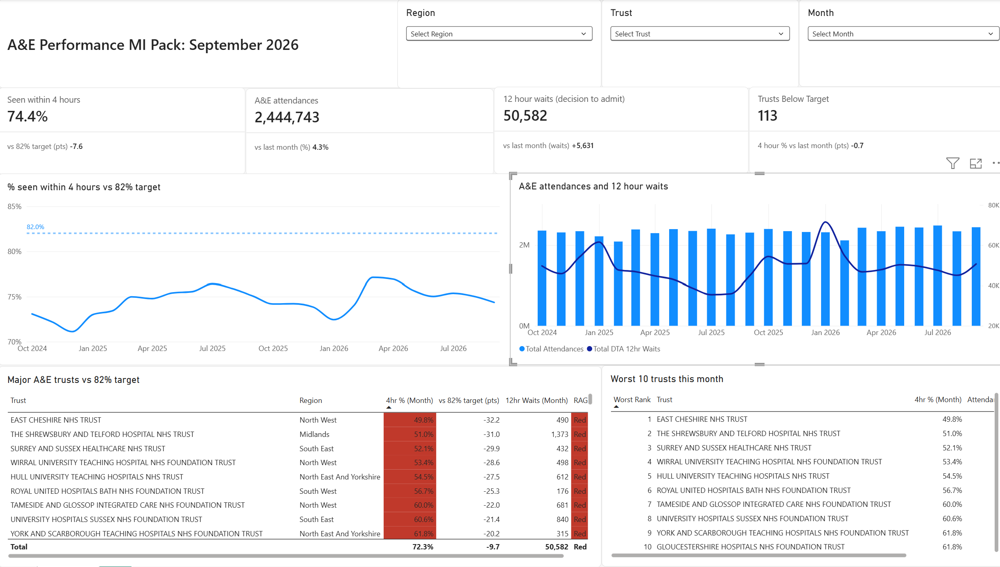

# NHS A&E Service Performance Reporting Pack

A monthly MI pack for A&E performance in England, built the way a service reporting or MI analyst would build it: KPIs against the national target, a RAG table of trusts, trend lines, a written monthly commentary, and a refresh that takes a new month's file with no rebuilding.

**Tools:** Python (pandas), SQL (SQLite), Power BI (Power Query, DAX)



## Business question

Each month, how is A&E performance in England tracking against the 82% four hour target, which regions and trusts are furthest off it, and what changed since last month?

## Data source

NHS England, **A&E Attendances and Emergency Admissions**, monthly provider level CSVs, October 2024 to September 2026 (24 months, 4,721 provider rows).
https://www.england.nhs.uk/statistics/statistical-work-areas/ae-waiting-times-and-activity/

The exact file URL for each month is in [`data/sources.csv`](data/sources.csv). Each file ends with a national total row; the cleaning script removes it and checks that the provider rows add up to it exactly, for every month.

## KPI definitions

| KPI | Definition |
|---|---|
| % seen within 4 hours | (all A&E attendances minus attendances over 4 hours) / all A&E attendances, all department types |
| Total attendances | all A&E attendances, all department types |
| 12 hour waits | patients waiting 12+ hours from decision to admit to admission |
| Month on month change | this month minus last month (points for the 4 hour %) |
| Target | **82% within 4 hours**: "Every trust to maintain or improve to 82% by March 2027", NHS England [Medium Term Planning Framework](https://www.england.nhs.uk/wp-content/uploads/2025/10/medium-term-planning-framework-delivering-change-together-2026-27-to-2028-29.pdf), page 30 |
| RAG | Green 82%+, Amber 78% to 81.9% (the 2025/26 minimum in the [2025/26 planning guidance](https://www.england.nhs.uk/long-read/2025-26-priorities-and-operational-planning-guidance/)), Red under 78% |

The RAG table and worst 10 list cover the 120 trusts with a major (Type 1) A&E, so walk in centres do not sit at the top with 100%. Headline national figures include all department types, which is how NHS England reports them. Full detail: [`docs/kpi_definitions.md`](docs/kpi_definitions.md).

## Findings (September 2026)

1. **Performance is 7.6 points below target and slipping.** 74.4% were seen within 4 hours, down 0.7 points on August and below September 2025 (75.1%). Over 24 months the best month was March 2026 at 77.1%; the target of 82% was not reached in any month.
   *Source: `outputs/national_monthly.csv`, `outputs/year_on_year.csv`*
2. **Only 7 of 120 major A&E trusts met the target.** 16 were Amber and 97 were Red. The lowest was East Cheshire at 49.8%, and 4 of the 10 worst trusts were in the North West, which also had the biggest regional fall (down 1.5 points to 71.8%).
   *Source: `outputs/rag_latest.csv`, `outputs/worst10_latest.csv`, `outputs/region_mom.csv`*
3. **Demand and 12 hour waits rose together.** Attendances rose 4.3% in a month to 2,444,743 (134,521 more than September 2025), and 12 hour waits from decision to admit rose by 5,631 to 50,582. Six of seven regions got worse, so the pressure was system wide.
   *Source: `outputs/national_monthly.csv`, `outputs/year_on_year.csv`, `outputs/region_mom.csv`*

The full monthly commentary is in [`docs/commentary_sep2026.md`](docs/commentary_sep2026.md).

## Dashboard

One page MI pack in Power BI ([`powerbi/AE_MI_Pack.pbix`](powerbi/AE_MI_Pack.pbix)):

* KPI cards: % seen within 4 hours (vs target), attendances, 12 hour waits, trusts below target, each with the change from last month
* Trend lines: 4 hour % against the 82% target; attendances and 12 hour waits
* RAG table of all major A&E trusts, coloured by a DAX measure
* Worst 10 trusts this month, using a DAX rank measure
* Slicers for region, trust and month

The reporting month is the latest month in the data unless one is picked in the slicer. A few measures were renamed in the report for display (for example `Gap to Target pts` shows as "vs 82% target (pts)"). All DAX measures are in [`powerbi/measures.dax`](powerbi/measures.dax) and [`powerbi/measures_fix1.dax`](powerbi/measures_fix1.dax).

## How to refresh with a new month

1. Download the new month's CSV from the NHS England page above.
2. Save it into `data/raw/` named `ae_YYYY-MM.csv`.
3. In Power BI, click **Home > Refresh**.

Power Query ([`powerbi/ae_monthly_query.m`](powerbi/ae_monthly_query.m)) reads every CSV in the folder, so the new month is appended and every card, chart and table moves to it with no rebuilding. This was tested by holding back September 2026 and adding it at the end.

To update the SQL outputs as well:

```bash
pip install -r requirements.txt
python src/01_load_clean.py
python src/02_kpis.py
```

## Project structure

```
data/raw/            monthly NHS England CSVs (one per month)
data/sources.csv     download URL for each month
src/01_load_clean.py combine, clean and check the files, save to SQLite
sql/kpis.sql         KPI queries (national, region, RAG, worst 10, movers)
src/02_kpis.py       runs each query and saves it to outputs/
outputs/             query results: the source of every number in this README
powerbi/             Power BI report, Power Query code and DAX measures
docs/                KPI definitions, commentary, dashboard screenshot
```
